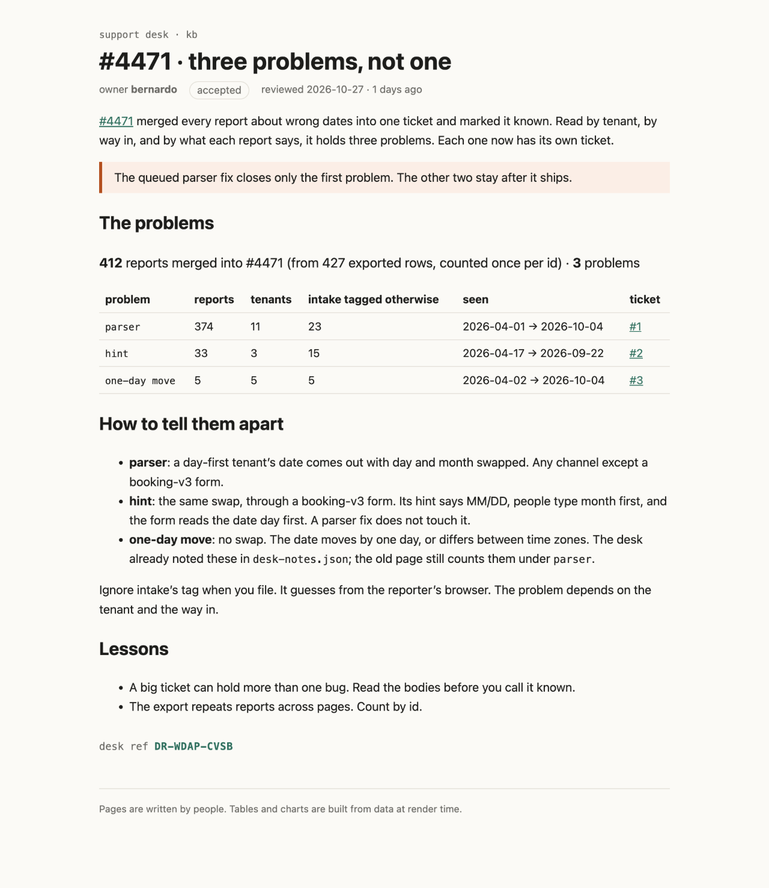

# The page as the desk sees it

`src/routes/kb/incidents/4471-split/+page.svx`, built with SvelteKit and mdsvex (layout `runbook`).

- `4471-split.html`: the prerendered page, CSS inlined, scripts removed.
- `4471-split.png`: a screenshot of it.

